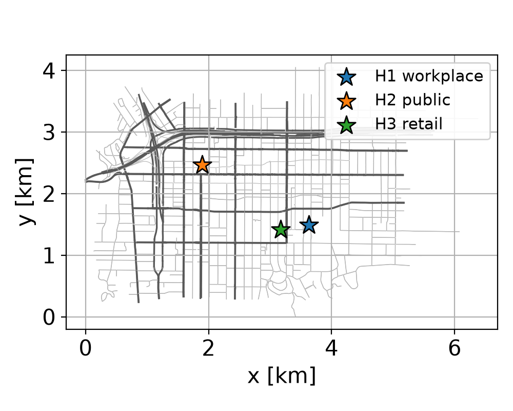
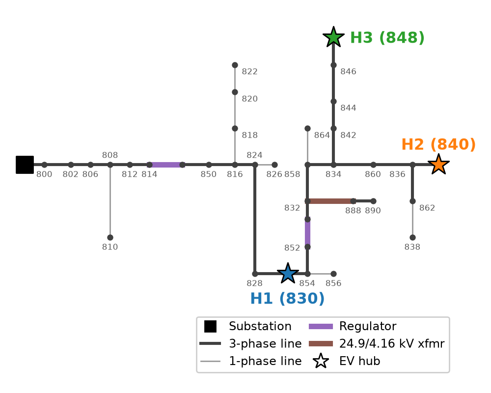
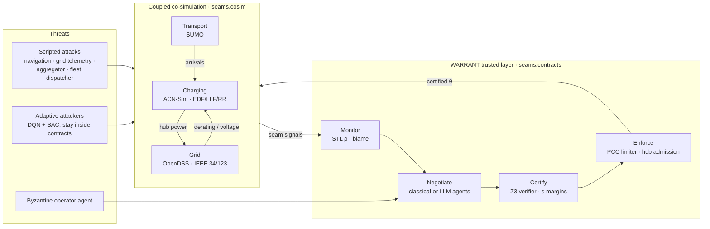
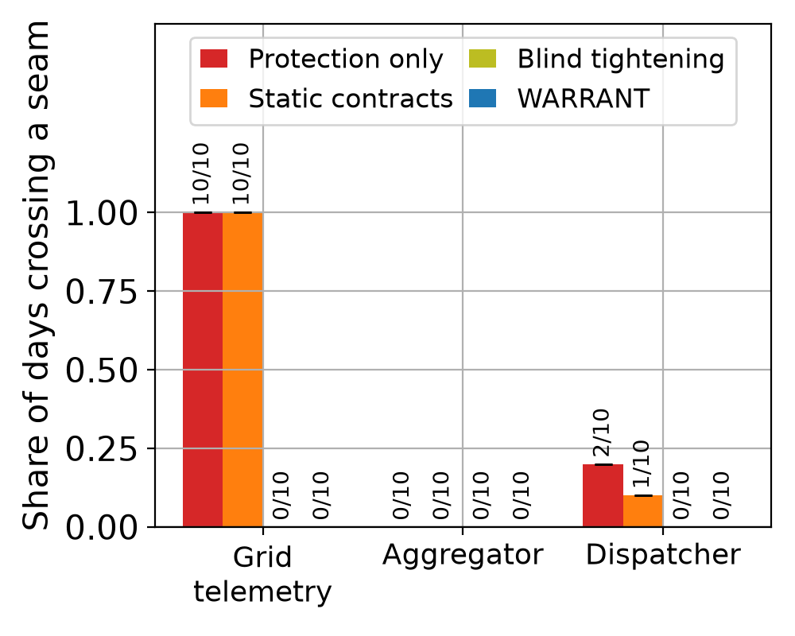
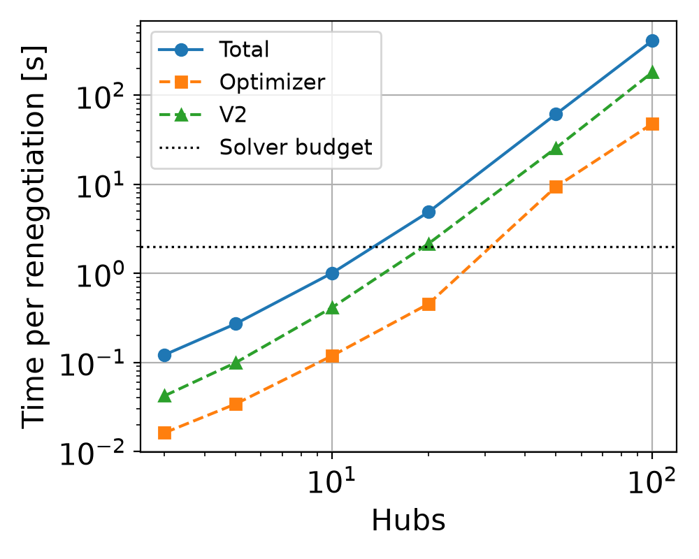

<h1 align="center">WARRANT: Runtime Containment of Attacks Across Mutually Distrusting Cyber-Physical Operators</h1>

<p align="center">
  <b>Runtime assume–guarantee contracts at the seams between transport, EV charging and the power grid</b><br>
  with physics-consistent blame, certified enforcement between checks, and verifier-gated negotiation by LLM agents
</p>

<p align="center">
  
  
  
  
  
  
  
</p>

---

Every electric-vehicle charge depends on three independent operators. A **fleet / navigation
operator** (SUMO) routes the vehicle, a **charging operator** (ACN-Sim) powers it, and a
**utility** (OpenDSS, IEEE 34 and IEEE 123 feeders) keeps the feeder inside the ANSI voltage band
and its transformers within rating. Each one verifies its own system, but none shares its model or
trusts the others, so an attack on one surfaces as a failure in another. If an attacker falsifies
the grid's voltage readings, the charging operator throttles its hubs and drivers leave
undercharged, even though every operator's own checks pass.

**WARRANT** places runtime contracts at the *seams* between operators and enforces them from a
thin trusted layer of meters and power limiters. The key observation is that physics makes the
grid's promises checkable: a hub's power draw shifts its voltage predictably, so a neighbour can
expose a falsified reading with only its own meter and the grid's published sensitivities.

| | |
|---|---|
| **Monitor** | Signal temporal logic monitors check every seam contract once per period and **blame** the operator whose guarantee broke while its assumption held. The grid's physics guarantee ties reported voltage to metered power, so a falsified reading breaks a promise the grid itself made. |
| **Certify** | A Z3 verifier (exact rationals) proves that a contract keeps the feeder safe at *every fine step* of the next hour, not only at checks, with calibrated ε-margins for linearisation and inter-sample drift. Only certified contracts are enforced. |
| **Renegotiate** | After a blame, only the blamed operator's contract is degraded. The classical optimiser's certified decision is installed at once; operator agents (LLMs) may propose replacements under a **floor protocol**, but only the verifier admits them. Fallback order: certified agreement, then classical decision, then the offline-certified θ_safe. |
| **Enforce** | Two shields in the trusted layer, a point-of-common-coupling (PCC) limiter and a hub admission gate 250 m before each hub, enforce the contract in force at every fine step, using trusted measurements only. |

---

## Testbed and visualization

<p align="center">
  <a href="seams/results/video-demo/combined_attacks.mp4">
    
  </a>
  <br>
  <sub><b>▶ Click for the full 2.5-minute video</b> (<a href="seams/results/video-demo/combined_attacks.mp4">combined_attacks.mp4</a>, 1080p).
  The preview runs at 8× speed.</sub>
</p>

The demo runs the real co-simulation, with no replay. Each scenario shows **protection only
(top)** and **WARRANT (bottom)** side by side, on the same seed:

1. **Falsified grid telemetry.** H1's reported feeder voltage is biased low (IEEE 34, today's load).
2. **Compromised aggregator.** It holds every charger at zero, then releases them all at full rate (IEEE 34, 2035).
3. **Navigation app compromise.** Fake "free chargers at H1" offers redirect drivers who are heading to other hubs (IEEE 34, 2035).

Each panel shows one simulator. **Transport (SUMO):** Pasadena streets, vehicles en route and
queues per hub. **Charging (ACN-Sim):** port tiles, hub power, the grid's derating allowance and
WARRANT's certified cap. **Grid (OpenDSS):** the IEEE 34 feeder coloured by voltage, true versus
reported hub voltage, and transformer loading. The event strip records the attack onset, IDS
alarms, blame, distrust and every contract change. To render your own videos, see
[`seams/viz/README.md`](seams/viz/README.md).

<table>
  <tr>
    <td align="center"><br><sub>Pasadena road network (SUMO) and the three hubs</sub></td>
    <td align="center"><br><sub>IEEE 34 feeder (OpenDSS) and hub connection points</sub></td>
    <td align="center"><br><sub>Hub occupancy over a day (ACN-Sim)</sub></td>
  </tr>
</table>

The testbed is built from public data. Charging sessions come from ACN-Data (Caltech, Pasadena)
and EV WATTS (Pacific region). Building load and weather come from NREL ResStock/ComStock for
Los Angeles County. Feeder load is scaled to *today*, *2035* and *2045* electrification as stress
levels (×1.0, ×1.25 and ×1.5 peak load; 10 %, 35 % and 70 % of households with a home
charger), with IEEE 34 at 2035 as the design point. The 6.4 × 4.0 km Pasadena network has three
hubs of 20 Level-2 ports behind 112.5 kVA transformers. A second IEEE 123 configuration replaces
them with 600 kW NEVI-class fast-charging hubs and adds a 7-port **robotaxi depot** at H2 that can
draw up to 1.3 MW from 20 robotaxis (90 kWh battery, 1 kW auxiliary load, repeated at 2 kW).

---

## Architecture



---

## Key results

All results come from **6,780 simulated days** plus **250 evaluation days for trained attackers**,
on real road, charging and load data. No day has an **unsound period** (a certified contract
followed within its horizon by an in-scope safety violation). Before each campaign we fixed an
expected outcome; where a result contradicts it, we say so.

<table>
  <tr>
    <td align="center" width="33%"><br><sub>Seam crossings by attack origin (robotaxi depot)</sub></td>
    <td align="center" width="33%"><br><sub>LLM floor negotiation vs classical, paired days</sub></td>
    <td align="center" width="33%"><br><sub>Certification time vs number of hubs</sub></td>
  </tr>
</table>

| RQ | Question | Finding |
|---|---|---|
| **RQ1** | Attribution and containment | Grid telemetry falsification (−0.04 p.u.) crosses a seam on **100 %** of protection-only days, although both baseline detectors alarm every time. WARRANT blames the grid within **6 min** and **contains every full-strength day**. At the robotaxi depot, a compromised dispatcher that no detector sees crosses on 2 of 10 days (4 of 10 with a 2 kW auxiliary load); WARRANT blames transport within 4 min and contains every day at every compromised share. False blame: 0.12 per attack-free day. |
| **RQ2** | Cost of containment | Free on the stiff IEEE 123 feeder and on IEEE 34 at today's load. On the weak IEEE 34 feeder: +19.5 kWh/day at 2035, +103 at 2045. Almost all of it lies in the ε-terms that make safety provable (45.1 kWh/day without them, vs 46.3 for protection only). A 30 min horizon cuts the extra cost by about a third. Blind tightening (no attribution) costs more on 61 of 62 differing days (p = 3 × 10⁻¹⁷). |
| **RQ3** | Compliant adversary | Within-contract attackers are never detected: the aggregator attacker adds 72.9 kWh/day within its caps, and navigation adds 21 vehicle-hours of delay. 16 inter-sample attackers cause **0 safety violations** with or without the ε-terms, which **refutes** our hypothesis that the ε-terms are what stop them. |
| **RQ4** | Negotiation without disclosure | Over 2,464 negotiations, agents agree in 59–63 % within at most 71 s of the 120 s window; only 10–24 % of proposals pass the verifier. Locked plans fall behind the classical optimiser (plan lock-in). Under the floor protocol, Gemini and Haiku improve on it by 0.28 and 0.30 kWh/day over 170 days (p < 10⁻⁹). All 1,100 agent days have zero unsound periods. |
| **RQ5** | Byzantine negotiator | Over 300 Byzantine days and 962 negotiations (4 strategies × 3 roles), no Φ_safe violation or unsound period. A compromised agent costs at most 0.32 kWh/day vs its honest twin, and no strategy does worse than the classical optimiser on average. A stall limit cuts the no-agreement share from 100 % to 86 %. |

**Attack classes.** Together with the adaptive and Byzantine attackers, the scripted attacks
cover denial of service, load shifting and safety attacks:

| Class | Attack (origin) | Protection only | WARRANT |
|---|---|---|---|
| Data integrity | Telemetry falsification (G) | crosses 100 % | contains; blame 6 min |
| | Two falsified meters (G) | detector silent | blame 6 min; combined estimator contains except under heavy load on IEEE 34 |
| Denial of service | Navigation flood (T) | no crossing | blame on 60 % of days |
| | Depot dispatcher (T) | crosses 20 % | contains; blame 4 min |
| | Stalling agent | – | no loss |
| Load shifting | Aggregator release 13:00 / 18:30 / 21:00 (C) | +61 / +103 / +82 kWh/day; only 18:30 crosses (2 of 10 days at 2045) | contains every release; blames charging within 2 min on 58 of 60 days |
| Safety | Masking telemetry, +0.02 / +0.04 p.u. (G) | no added violation | blames the grid within 4–5 min on all 60 days (20 at the depot) |
| | Inter-sample attackers (16) | – | 0 violations |

<details>
<summary><b>Honest negative results and limits</b></summary>

- A **detector-triggered local response** (bad-data detection plus an MV-meter estimate) contains single-meter telemetry falsification equally well, but it trusts the suspected operator's meters, ignores charging and transport attacks, and names no one.
- When **two meters are falsified** so that the bad-data detector stays silent, that response crosses on every day. WARRANT still blames the grid through the trusted PCC meter, and the combined estimator contains every two-meter day except under heavy load on the weak feeder (never worse than either estimator alone, over 240 days).
- At the design point WARRANT's own certified cap already holds H1 near the derated level, so containment does **not** translate into more delivered energy there (73.0 vs 48.0 kWh/day on falsification days). On IEEE 123 and at today's load, containment also saves energy.
- Containment holds at every load level except IEEE 34 at 2045 (6 of 10 days), where voltage already sits near the derating knee.
- Attribution reaches only 60 % of navigation days and half the depot days with a quarter of the fleet compromised, when the surge stays within the quotas; then no one is blamed and nothing crosses.
- Slower ramps narrow the race but do not win it: up to a 40 min ramp WARRANT contains all 50 days, though its lead shrinks from 5 to 1.5 min.
- A frozen meter remains a blind spot.
- Certification fits the 2 s budget up to about 10–15 hubs (renegotiation time grows as ~n^2.6: 1.0 s at 10 hubs, 61 s at 50).
- The evidence comes from one road network and two IEEE feeders; most cells cover 10 days, and the guarantees hold only under assumptions A1–A4.

</details>

<details>
<summary><b>All campaigns</b></summary>

| Campaign | Design | Days |
|---|---|---:|
| `rq1` | 3 attacks × 4 strengths + nominal; protection only / static / WARRANT; EDF / LLF / RR | 1,170 |
| `rq2` | contract scale c ∈ {0.6, 0.8, 1, 1.25}; oracle comparison | 780 |
| `electrification`, `feeder123` | today / 2035 / 2045 on IEEE 34 and IEEE 123 | 480 |
| `delta` | contract period Δ ∈ {60, 120, 300} s | 120 |
| `dwell` | dwell time × 0.5 | 100 |
| `blind` | blind tightening (no attribution) | 130 |
| `fdi_morning` | grid-telemetry falsification at 08:30 | 160 |
| `detect_respond` | detector-triggered response; falsification ramp rates | 220 |
| `disturbances` | honest capacitor trips, load steps, stuck meter | 240 |
| `two_meter` | coordinated LV + MV falsification | 140 |
| `peak_shift` | aggregator release at 13:00 / 18:30 / 21:00; 2035 and 2045 | 160 |
| `fdi_mask` | safety-masking telemetry, +0.02 / +0.04 p.u. at H1; 2035 and 2045 | 120 |
| `depot_mask` | safety-masking telemetry at the robotaxi depot (IEEE 123, 2035) | 60 |
| `anchor_screen`, `both_eval` | PCC-anchor and combined distrust estimators | 420 |
| `cost_decomp`, `horizon30` | ε-term cost decomposition; 30 min verifier horizon | 250 |
| `depot`, `depot_aux2kW` | fast-charging hubs and robotaxi depot on IEEE 123 (1 kW and 2 kW AV auxiliary load) | 880 |
| `rq4`, `rq4_conservatism` | classical vs Gemini / Haiku × {lock, floor}; unforeseen faults | 1,010 |
| `rq5` | 4 Byzantine strategies × 3 roles × {nominal, attack} | 340 |
| `rq3` (`train_attackers`) | trained within-contract and inter-sample attackers × 10 held-out days | 250 |
| `scaling` | synthetic n-hub certification, n ≤ 100 (solver only) | – |
| `both_dev` | development run for the combined estimator (seeds 3000–3009, not counted above) | 90 |
| **Total** | 6,780 simulated days + 250 trained-attacker days | **7,030** |

Specifications are in [`seams/experiments/campaigns/`](seams/experiments/campaigns). Summaries are in
[`seams/results/`](seams/results) (`*_summary.parquet`, `*_table.csv`). Every figure is in
[`seams/results/figures/`](seams/results/figures) as PNG and PDF.

</details>

---

## Repository layout

```
.
├── run_all.sh                 # one-command, resumable end-to-end pipeline
├── requirements.txt           # pinned Python dependencies
├── seams/requirements.lock    # full frozen environment used for the paper runs
├── LICENSE                    # MIT
├── adaptive_rl/               # Transformer IDS model and training recipe (detection baseline)
├── docs/media/                # README media (video preview)
└── seams/
    ├── cosim/                 # master clock, config loader, logger: couples the three simulators
    ├── domains/
    │   ├── transport/         # SUMO: fleet, routing, robotaxi AVs
    │   ├── charging/          # ACN-Sim hubs, home charging, malicious scheduler
    │   ├── grid/              # OpenDSS feeder, derating, PCC meter, telemetry, protection
    │   └── bridge/            # hand-off between domains
    ├── contracts/             # contract grammar, STL monitors, ε-margins, Z3 verifier, renegotiation
    ├── shields/               # PCC limiter and hub admission (enforcement)
    ├── agents/                # LLM operator agents, verifier gate, protocol, replay cache
    ├── attacks/
    │   ├── scripted/          # navigation, telemetry falsification, aggregator, dispatcher, disturbances
    │   └── adaptive/          # Gymnasium environments for the two-layer RL attacker
    ├── baselines/             # protection only, bad-data detection, IDS, oracle
    ├── experiments/           # run, campaign, calibrate, train_attackers, train_ids, scaling, pipeline
    ├── analysis/              # every table and figure (one figure per file, PNG + PDF)
    ├── viz/                   # live three-domain view and video recorder
    ├── config/                # phase configs, calibrated contracts, attack specs
    ├── scenarios/             # Pasadena SUMO network, IEEE 34 / IEEE 123 feeders
    ├── data/                  # data preparation and processed tables
    ├── models/                # calibrated bad-data detectors, retrained Transformer IDS
    ├── results/               # campaign summaries, tables, figures, demo video
    └── tests/                 # pytest suite
```

---

## Installation

**1. Python 3.11 environment**

```bash
conda create -n seams python=3.11 -y
conda activate seams
pip install -r requirements.txt
```

**2. SUMO 1.28**

Install [Eclipse SUMO](https://sumo.dlr.de/docs/Installing/index.html) 1.28 (from a release or
built from source) and point `SUMO_HOME` at it:

```bash
export SUMO_HOME=~/sumo        # default if unset: ~/sumo (seams/config/phase0.yaml)
```

> **Tip:** If your checkout path contains spaces or parentheses, keep it out of any `.sumocfg`. The code writes only relative paths there.

**3. (Optional) LLM agents**

Only RQ4 and RQ5 call an LLM. The negotiation protocol is a LangGraph state machine with one
agent per operator, using Gemini 3.6 Flash (temperature 0) and, as an ablation, Claude Haiku 5.5,
through [OpenRouter](https://openrouter.ai):

```bash
cp .env.example .env           # then set OPENROUTER_API_KEY
```

Responses are recorded in a replay cache (`~/seams_runs/llm_cache.sqlite`), so a second run of
the same campaign costs nothing. All 1,100 agent days cost under US$50 in LLM calls.

---

## Quick start

Run everything from the repository root:

```bash
export PYTHONPATH="$PWD"

# test suite (parallel, about 30 min)
python -m pytest seams/tests

# one simulated day: RQ1 scenario, WARRANT, grid-telemetry falsification
python -m seams.experiments.run seams/config/phase5.yaml --seed 2000 --attack seams/config/attacks/fdi.yaml

# live three-domain view: protection only vs WARRANT on the same day
python -m seams.viz.live fdi --electrification today
python -m seams.viz.live aggregator --electrification 2045 --save aggregator.mp4

# rebuild every table and figure (PNG + PDF) from the shipped summaries
./run_all.sh --stages figures
```

## Reproducing the paper

```bash
./run_all.sh --dry-run          # show what would run
./run_all.sh                    # every stage except tests; finished outputs are reused
./run_all.sh --stages campaigns --workers 9
```

| Stage | What it does |
|---|---|
| `tests` | full pytest suite |
| `data` | raw public datasets → `seams/data/processed` (already shipped) |
| `calibrate` | static and safe contracts plus the bad-data detector for every feeder × load × Δ (already shipped in `seams/config`, `seams/models`) |
| `ids` | retrains the Transformer IDS (`seams/models/ids_transformer_testbed.pkl`, already shipped) |
| `campaigns` | all non-LLM campaigns and the certification-scaling study |
| `rq3` | the 25 adaptive attackers, in dependency order |
| `agents` | RQ4, RQ4 conservatism, RQ5 (LLM) |
| `figures` | every table and figure |

Raw run data goes to `~/seams_runs/<campaign>/`, outside the repository. A campaign skips every
run that already has `metrics.json`, so an interrupted campaign resumes where it stopped. From
scratch on 10 cores the pipeline takes several days (RQ3 alone about 2.5 days). Launch long
stages detached, for example `nohup ./run_all.sh --stages campaigns > campaigns.log 2>&1 &`.

> **Note:** Any process that has imported `libsumo` cannot call `pandas.read_parquet`, because of a conflicting Arrow build. Analysis modules therefore read results in their own process.

**Seed discipline.** Evaluation uses seeds 2000–2009. Training and development use 3000–3009.
Calibration uses 1000–1009. No method or attack was tuned on evaluation seeds.

---

## Data

The processed tables needed to run the testbed ship in `seams/data/processed/`. Rebuilding them
with `python -m seams.data.prepare` needs these raw public datasets, which are not redistributed
here:

| Source | Used for | Location expected by `prepare` |
|---|---|---|
| [ACN-Data](https://ev.caltech.edu/dataset) (Caltech, Pasadena; Lee, Li & Low, e-Energy 2019) | workplace charging sessions | `adaptive_rl/acndata/` |
| [EV WATTS](https://livewire.energy.gov/project/evwatts) (DOE / Energetics), Pacific region | public, retail, home and DC fast-charging sessions; SOC at plug-in; trip lengths | `adaptive_rl/evcs_data/evwatts.public/` |
| [NREL ResStock / ComStock](https://www.nrel.gov/buildings/end-use-load-profiles.html) 2021, AMY 2018, Los Angeles County | feeder load shape and ambient temperature | `~/seams_data/raw/` (`--raw`) |

The road network is built from OpenStreetMap (© OpenStreetMap contributors, ODbL). The IEEE 34
and IEEE 123 feeders are the standard OpenDSS test cases.

---

## `adaptive_rl`

`adaptive_rl/` holds the session-level **Transformer IDS** used as a detection baseline:
`ids_neural_models.py` (architecture) and `ids_training.py` (synthetic false-data injections and
the training loop). `seams.experiments.train_ids` retrains it on this testbed using calibration
seeds only. It is never trained on the scripted attacks it is later scored against.

---

## Citation

The paper, *Warrant: Runtime Containment of Attacks Across Mutually Distrusting Cyber-Physical
Operators*, is under review. Citation details will be added once it is published.

## License

Released under the [MIT License](LICENSE).
