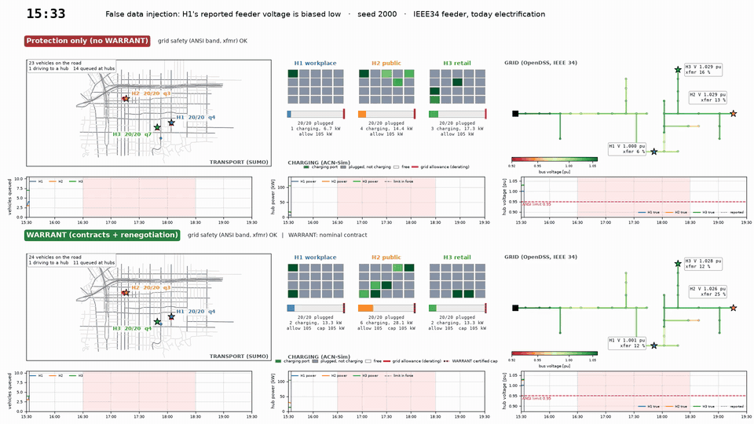
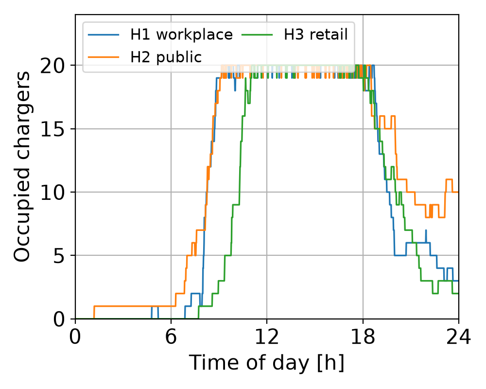
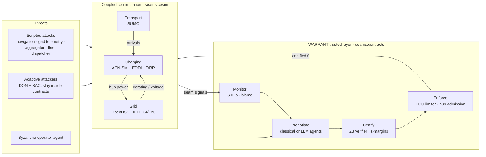
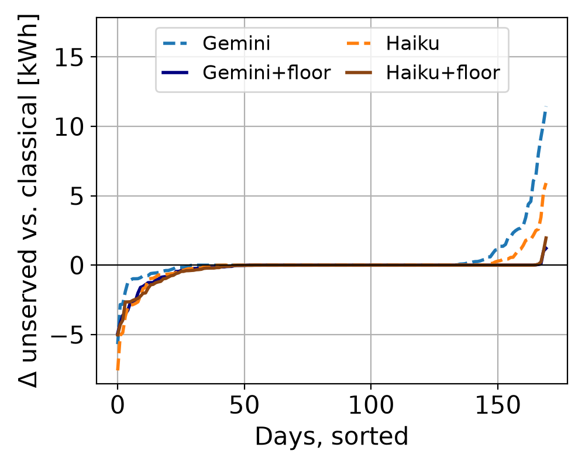

<h1 align="center">WARRANT: Certified Seam Contracts</h1>

<p align="center">
  <b>Assume–guarantee contracts at the seams between transport, EV charging and the power grid</b><br>
  with physics-consistent blame, verifier-gated renegotiation by LLM agents, and a Byzantine analysis
</p>

<p align="center">
  
  
  
  
  
  
  
</p>

---

Three operators share one cyber-physical chain. A **fleet / navigation operator** (SUMO) sends
electric vehicles to charging hubs. A **charging operator** (ACN-Sim) schedules them. A
**utility** (OpenDSS, IEEE 34 and IEEE 123 feeders) keeps the feeder inside the ANSI voltage band
and its transformers within rating. Each operator protects its own domain, so an attack on one
domain can cascade across the *seams* into the others. Today's protection notices the effect,
but nobody is held responsible for the cause.

**WARRANT** puts machine-checked assume–guarantee contracts on those seams:

| | |
|---|---|
| **Monitor** | Signal temporal logic monitors on every seam signal compute robustness ρ and assign **blame** to the operator whose guarantee broke. The checks are physics-consistent, so a falsified meter cannot shift the blame. |
| **Certify** | A Z3 verifier proves that a contract keeps the feeder safe *between* samples over a 1 h horizon, with explicit ε-margins for linearisation and disturbance. Only certified contracts are installed. |
| **Renegotiate** | When an operator is blamed, the contract degrades that operator only. Operators (classical optimiser or LLM agents) propose new contracts, and **every proposal passes the same verifier gate**. |
| **Enforce** | A point-of-common-coupling (PCC) limiter and a hub admission gate enforce the certified contract inside each domain. |

---

## Testbed and visualization

<p align="center">
  <a href="seams/results/video-demo/combined_attacks.mp4">
    
  </a>
  <br>
  <sub><b>▶ Click for the full 2.5-minute video</b> (<a href="seams/results/video-demo/combined_attacks.mp4">combined_attacks.mp4</a>, 1080p).
  The preview runs at 8× speed.</sub>
</p>

The demo runs the real co-simulation, with no replay. Each scenario shows **protection only
(top)** and **WARRANT (bottom)** side by side, on the same seed:

1. **Falsified grid telemetry.** H1's reported feeder voltage is biased low (IEEE 34, today's load).
2. **Compromised aggregator.** It holds every charger at zero, then releases them all at full rate (IEEE 34, 2035).
3. **Navigation app compromise.** Fake "free chargers at H1" offers redirect drivers who are heading to other hubs (IEEE 34, 2035).

Each panel shows one simulator. **Transport (SUMO):** Pasadena streets, vehicles en route and
queues per hub. **Charging (ACN-Sim):** port tiles, hub power, the grid's derating allowance and
WARRANT's certified cap. **Grid (OpenDSS):** the IEEE 34 feeder coloured by voltage, true versus
reported hub voltage, and transformer loading. The event strip records the attack onset, IDS
alarms, blame, distrust and every contract change. To render your own videos, see
[`seams/viz/README.md`](seams/viz/README.md).

<table>
  <tr>
    <td align="center"><br><sub>Pasadena road network (SUMO) and the three hubs</sub></td>
    <td align="center"><br><sub>IEEE 34 feeder (OpenDSS) and hub connection points</sub></td>
    <td align="center"><br><sub>Hub occupancy over a day (ACN-Sim)</sub></td>
  </tr>
</table>

The testbed is built from public data. Charging sessions come from ACN-Data (Caltech, Pasadena)
and EV WATTS (Pacific region). Building load and weather come from NREL ResStock/ComStock for
Los Angeles County. Feeder load is scaled to *today*, *2035* and *2045* electrification as stress
levels. A fast-charging variant uses NEVI-class hubs (4 × 150 kW ports) and adds a 7-port
**robotaxi depot** served by a 20-vehicle AV fleet.

---

## Architecture



---

## Key results

All results come from **6,440 simulated days** and **250 trained-attacker days**. Every campaign
has **0 unsound certified periods** and **0 in-scope safety violations**. The paper reports
negative results as well as positive ones.

<table>
  <tr>
    <td align="center" width="33%"><br><sub>Seam crossings by attack origin (robotaxi depot)</sub></td>
    <td align="center" width="33%"><br><sub>LLM floor negotiation vs classical, paired days</sub></td>
    <td align="center" width="33%"><br><sub>Certification time vs number of hubs</sub></td>
  </tr>
</table>

| RQ | Question | Finding |
|---|---|---|
| **RQ1** | Containment and attribution | Falsified grid telemetry at −0.04 p.u. crosses a seam on **100 %** of protection-only days. WARRANT **contains 100 %** and blames the grid within ≤ 6 min. A compromised robotaxi dispatcher is invisible to the bad-data detector, yet WARRANT blames transport on 10/10 days and contains every one. |
| **RQ2** | Price of certification | +19.5 kWh/day of unserved energy at 2035 on IEEE 34, and about 0 on IEEE 123. The ε-terms account for almost the whole cost. Tighter contracts are cheaper. Without attribution (blind tightening), the same containment costs more on 61 of 62 differing days (p = 3e−17). |
| **RQ3** | Adaptive attackers | 25 trained attackers. Attacks inside the contract still cost +72.9 kWh/day (aggregator), but there are **0 safety violations** across all 16 inter-sample attackers. Hypothesis H3 is **refuted** and reported as such. |
| **RQ4** | LLM renegotiation | With a verifier-gated floor, LLM agents beat the classical optimiser on 52 of 58 differing days (p = 3e−10). Naive plan lock-in is not significant. |
| **RQ5** | Byzantine agents | Across 4 strategies × 3 roles, no Byzantine strategy does worse than classical on average. Safety never depends on the agents. |

<details>
<summary><b>Honest negative results and limits</b></summary>

- A **detector-triggered local response** (bad-data detection plus an MV-side estimate) also contains single-meter telemetry falsification, at zero attack-free cost.
- A **coordinated two-meter falsification** silences the bad-data detector and poisons the MV estimate. WARRANT still blames the grid, but with the MV estimator it crosses on 10/10 days. The combined `both` estimator contains it at IEEE 34 / 2035. At IEEE 34 / 2045, 6 of 10 days still cross.
- At 2035 WARRANT's own certified cap already constrains H1, so containment does **not** translate into more delivered energy on those days.
- A stuck meter is a blind spot: 1 of 10 days blamed, after 2 h.
- Certification fits a 2 s budget up to about 10–15 hubs (total time grows as ~n^2.6).

</details>

<details>
<summary><b>All campaigns</b></summary>

| Campaign | Design | Days |
|---|---|---:|
| `rq1` | 3 attacks × 4 strengths + nominal; protection only / static / WARRANT; EDF / LLF / RR | 1,170 |
| `rq2` | contract scale c ∈ {0.6, 0.8, 1, 1.25}; oracle comparison | 780 |
| `electrification`, `feeder123` | today / 2035 / 2045 on IEEE 34 and IEEE 123 | 480 |
| `delta` | contract period Δ ∈ {60, 120, 300} s | 120 |
| `dwell` | dwell time × 0.5 | 100 |
| `blind` | blind tightening (no attribution) | 130 |
| `fdi_morning` | grid-telemetry falsification at 08:30 | 160 |
| `detect_respond` | detector-triggered response; falsification ramp rates | 220 |
| `disturbances` | honest capacitor trips, load steps, stuck meter | 240 |
| `two_meter` | coordinated LV + MV falsification | 140 |
| `anchor_screen`, `both_eval` | PCC-anchor and combined distrust estimators | 420 |
| `cost_decomp`, `horizon30` | ε-term cost decomposition; 30 min verifier horizon | 250 |
| `depot`, `depot_aux2kW` | fast-charging hubs and robotaxi depot on IEEE 123 (1 kW and 2 kW AV auxiliary load) | 880 |
| `rq4`, `rq4_conservatism` | classical vs Gemini / Haiku × {lock, floor}; unforeseen faults | 1,010 |
| `rq5` | 4 Byzantine strategies × 3 roles × {nominal, attack} | 340 |
| `rq3` (`train_attackers`) | 25 trained attackers × 10 held-out days | 250 |
| `scaling` | synthetic n-hub certification, n ≤ 100 (solver only) | – |
| `both_dev` | development run for the combined estimator (seeds 3000–3009, not counted above) | 90 |

Specifications are in [`seams/experiments/campaigns/`](seams/experiments/campaigns). Summaries are in
[`seams/results/`](seams/results) (`*_summary.parquet`, `*_table.csv`). Every figure is in
[`seams/results/figures/`](seams/results/figures) as PNG and PDF.

</details>

---

## Repository layout

```
.
├── run_all.sh                 # one-command, resumable end-to-end pipeline
├── requirements.txt           # pinned Python dependencies
├── LICENSE                    # MIT
├── adaptive_rl/               # Transformer IDS model and training recipe (detection baseline)
├── docs/media/                # README media (video preview)
└── seams/
    ├── cosim/                 # master clock, config loader, logger: couples the three simulators
    ├── domains/
    │   ├── transport/         # SUMO: fleet, routing, robotaxi AVs
    │   ├── charging/          # ACN-Sim hubs, home charging, malicious scheduler
    │   ├── grid/              # OpenDSS feeder, derating, PCC meter, telemetry, protection
    │   └── bridge/            # hand-off between domains
    ├── contracts/             # contract grammar, STL monitors, ε-margins, Z3 verifier, renegotiation
    ├── shields/               # PCC limiter and hub admission (enforcement)
    ├── agents/                # LLM operator agents, verifier gate, protocol, replay cache
    ├── attacks/
    │   ├── scripted/          # navigation, telemetry falsification, aggregator, dispatcher, disturbances
    │   └── adaptive/          # Gymnasium environments for the two-layer RL attacker
    ├── baselines/             # protection only, bad-data detection, IDS, oracle
    ├── experiments/           # run, campaign, calibrate, train_attackers, train_ids, scaling, pipeline
    ├── analysis/              # every table and figure (one figure per file, PNG + PDF)
    ├── viz/                   # live three-domain view and video recorder
    ├── config/                # phase configs, calibrated contracts, attack specs
    ├── scenarios/             # Pasadena SUMO network, IEEE 34 / IEEE 123 feeders
    ├── data/                  # data preparation and processed tables
    ├── models/                # calibrated bad-data detectors, retrained Transformer IDS
    ├── results/               # campaign summaries, tables, figures, demo video
    └── tests/                 # pytest suite
```

---

## Installation

**1. Python 3.11 environment**

```bash
conda create -n seams python=3.11 -y
conda activate seams
pip install -r requirements.txt
```

**2. SUMO 1.28**

Install [Eclipse SUMO](https://sumo.dlr.de/docs/Installing/index.html) 1.28 (from a release or
built from source) and point `SUMO_HOME` at it:

```bash
export SUMO_HOME=~/sumo        # default if unset: ~/sumo (seams/config/phase0.yaml)
```

> **Tip:** If your checkout path contains spaces or parentheses, keep it out of any `.sumocfg`. The code writes only relative paths there.

**3. (Optional) LLM agents**

Only RQ4 and RQ5 call an LLM, through [OpenRouter](https://openrouter.ai):

```bash
cp .env.example .env           # then set OPENROUTER_API_KEY
```

Responses are recorded in a replay cache (`~/seams_runs/llm_cache.sqlite`), so a second run of
the same campaign costs nothing.

---

## Quick start

Run everything from the repository root:

```bash
export PYTHONPATH="$PWD"

# test suite (parallel, about 30 min)
python -m pytest seams/tests

# one simulated day: RQ1 scenario, WARRANT, grid-telemetry falsification
python -m seams.experiments.run seams/config/phase5.yaml --seed 2000 --attack seams/config/attacks/fdi.yaml

# live three-domain view: protection only vs WARRANT on the same day
python -m seams.viz.live fdi --electrification today
python -m seams.viz.live aggregator --electrification 2045 --save aggregator.mp4

# rebuild every table and figure (PNG + PDF) from the shipped summaries
./run_all.sh --stages figures
```

## Reproducing the paper

```bash
./run_all.sh --dry-run          # show what would run
./run_all.sh                    # every stage except tests; finished outputs are reused
./run_all.sh --stages campaigns --workers 9
```

| Stage | What it does |
|---|---|
| `tests` | full pytest suite |
| `data` | raw public datasets → `seams/data/processed` (already shipped) |
| `calibrate` | static and safe contracts plus the bad-data detector for every feeder × load × Δ (already shipped in `seams/config`, `seams/models`) |
| `ids` | retrains the Transformer IDS (`seams/models/ids_transformer_testbed.pkl`, already shipped) |
| `campaigns` | all non-LLM campaigns and the certification-scaling study |
| `rq3` | the 25 adaptive attackers, in dependency order |
| `agents` | RQ4, RQ4 conservatism, RQ5 (LLM) |
| `figures` | every table and figure |

Raw run data goes to `~/seams_runs/<campaign>/`, outside the repository. A campaign skips every
run that already has `metrics.json`, so an interrupted campaign resumes where it stopped. From
scratch on 10 cores the pipeline takes several days (RQ3 alone about 2.5 days). Launch long
stages detached, for example `nohup ./run_all.sh --stages campaigns > campaigns.log 2>&1 &`.

> **Note:** Any process that has imported `libsumo` cannot call `pandas.read_parquet`, because of a conflicting Arrow build. Analysis modules therefore read results in their own process.

**Seed discipline.** Evaluation uses seeds 2000–2009. Training and development use 3000–3009.
Calibration uses 1000–1009. No method or attack was tuned on evaluation seeds.

---

## Data

The processed tables needed to run the testbed ship in `seams/data/processed/`. Rebuilding them
with `python -m seams.data.prepare` needs these raw public datasets, which are not redistributed
here:

| Source | Used for | Location expected by `prepare` |
|---|---|---|
| [ACN-Data](https://ev.caltech.edu/dataset) (Caltech, Pasadena; Lee, Li & Low, e-Energy 2019) | workplace charging sessions | `adaptive_rl/acndata/` |
| [EV WATTS](https://livewire.energy.gov/project/evwatts) (DOE / Energetics), Pacific region | public, retail, home and DC fast-charging sessions; SOC at plug-in; trip lengths | `adaptive_rl/evcs_data/evwatts.public/` |
| [NREL ResStock / ComStock](https://www.nrel.gov/buildings/end-use-load-profiles.html) 2021, AMY 2018, Los Angeles County | feeder load shape and ambient temperature | `~/seams_data/raw/` (`--raw`) |

The road network is built from OpenStreetMap (© OpenStreetMap contributors, ODbL). The IEEE 34
and IEEE 123 feeders are the standard OpenDSS test cases.

---

## `adaptive_rl`

`adaptive_rl/` holds the session-level **Transformer IDS** used as a detection baseline:
`ids_neural_models.py` (architecture) and `ids_training.py` (synthetic false-data injections and
the training loop). `seams.experiments.train_ids` retrains it on this testbed using calibration
seeds only. It is never trained on the scripted attacks it is later scored against.

---

## Citation

Citation details will be added once the paper is published.

## License

Released under the [MIT License](LICENSE).
